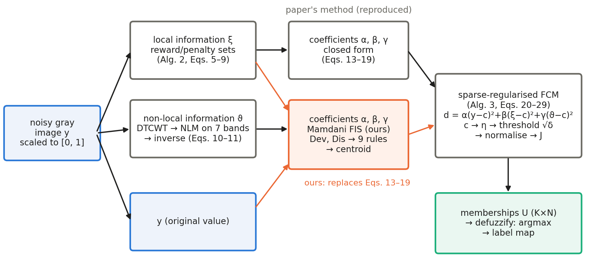
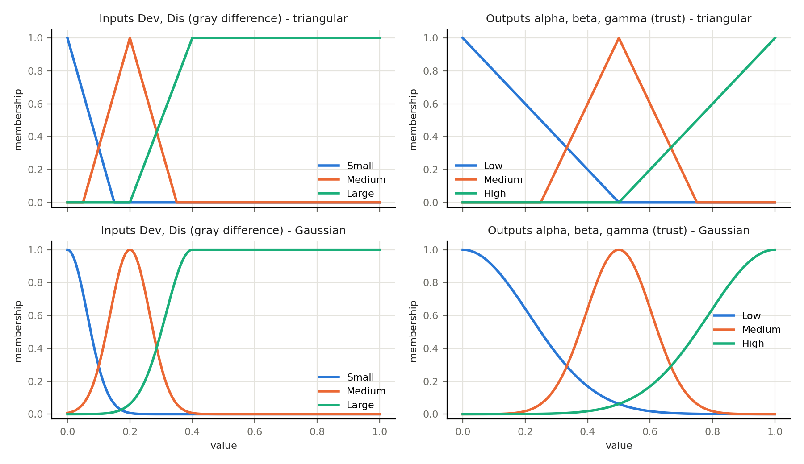
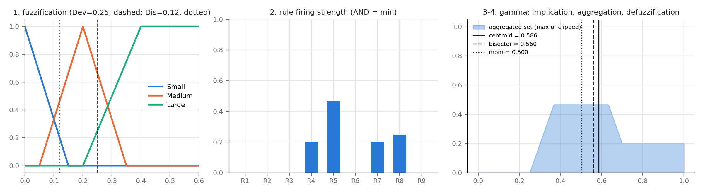

# Adaptive Sparse Regularized Fuzzy Clustering for Noisy Image Segmentation — Reproduction and a Fuzzy-Rule Extension

> Fuzzy Logic course term project. Report: [`report/report.pdf`](report/report.pdf) · Slides: [`presentation/presentation.pdf`](presentation/presentation.pdf) · Decisions and deviations from the paper: [`report/decisions.md`](report/decisions.md) · Checkpoint notes: [`report/checkpoints/`](report/checkpoints/)

## Project Title

Reproduction and extension of *"Adaptive sparse regularized fuzzy clustering noise image segmentation algorithm based on complementary spatial information"* (Wu et al., 2024): Fuzzy C-Means with local and wavelet-domain non-local spatial information and ℓ0 sparse regularization, extended with an explicit Mamdani fuzzy inference system for its per-pixel trust coefficients.

## Student Information

- **Name:** Tarık Öztaş
- **Student ID:** 1306230040
- **University / Department:** İstanbul Üniversitesi-Cerrahpaşa, Computer Engineering
- **Course:** Fuzzy Logic (Bulanık Mantık) — Term Project, 2026–2027 Fall

## Original Paper

J. Wu, X. Wang, Y. Liu, and C. Fang, "Adaptive sparse regularized fuzzy clustering noise image segmentation algorithm based on complementary spatial information," *Expert Systems With Applications*, vol. 256, Art. no. 124943, 2024, doi: [10.1016/j.eswa.2024.124943](https://doi.org/10.1016/j.eswa.2024.124943).

The paper PDF is not redistributed here (publisher copyright). All code in this repository was written from scratch for this project; no implementation by the authors was used (decision D-020).

## Problem Description

Image segmentation divides an image into homogeneous regions. Fuzzy C-Means (FCM) gives every pixel a degree of membership in each of K clusters, but it looks at each gray value in isolation and therefore breaks down under noise. The paper adds two corrected versions of every pixel — a local estimate built from golden-ratio reward/penalty sets of neighbours and a non-local estimate computed in the dual-tree complex wavelet domain — weighs the three values with per-pixel coefficients α, β, γ, and makes the membership matrix sparse with an ℓ0 penalty. The goal is robust segmentation under mixed Gaussian, salt-and-pepper and multiplicative noise with few iterations.

This project (1) re-implements FCM and the full method, (2) reproduces the paper's main synthetic experiments, ablation and BSDS500 experiment, (3) documents where the paper is ambiguous or inconsistent, and (4) replaces the paper's closed-form coefficient rule with an explicit, inspectable fuzzy rule base and evaluates it under controlled conditions.

## Method

| Step | Paper | Code |
|---|---|---|
| Baseline FCM | Alg. 1, Eqs. 1–3 | `src/fcm/baseline_fcm.py` |
| Local information ξ: neighbours sorted, the middle ⌊0.618·(N_R−1)⌋ form the reward set (weight 1+σ), the rest the penalty set (1−σ); gray and spatial similarity | Alg. 2, Eqs. 5–9 | `src/fcm/local_info.py` |
| Non-local information ϑ: one-level DTCWT (1 low-pass + 6 complex sub-bands), non-local means on each, inverse DTCWT | Eqs. 10–11 | `src/fcm/nonlocal_wavelet.py` |
| Adaptive coefficients α = 1/(ΔG1+ΔG2), β = ΔG1, γ = ΔG2 with ΔG = k·exp(y − ξ) | Eqs. 13–19 | `src/fcm/adaptive_params.py` |
| Sparse-regularised FCM: centres → η → hard threshold √δ → normalise | Alg. 3, Eqs. 20–29 | `src/fcm/sparse_fcm.py`, `src/fcm/pipeline.py` |
| **Extension:** α, β, γ from a Mamdani fuzzy inference system | — (ours) | `src/fuzzy/`, `src/fcm/fis_coefficients.py` |

Parameters (paper): w = 5, S = 15, υ = 4, g = 10, σ = 0.3, k = 15, δ = 0.4, m = 2, ε = 10⁻⁶, T = 100.

## Fuzzy System Architecture



**Fuzzy clustering part (paper).**

| Element | Realisation |
|---|---|
| Inputs | noisy gray image y ∈ [0, 1]; derived features ξ (local) and ϑ (non-local); number of clusters K |
| Fuzzy sets / membership functions | one fuzzy set per cluster; membership u_ij ∈ [0, 1] of pixel j in cluster i (Eq. 2 / 28), columns sum to 1; Gaussian similarity kernels inside ξ and ϑ |
| "Inference" | minimisation of the objective (Eq. 12 / 20): a pixel close to centre c_i in the weighted distance d_ij gets a high membership in cluster i |
| Defuzzification | label_j = argmax_i u_ij |
| Outputs | membership matrix U, cluster centres, label map |

**Mamdani fuzzy inference system (extension, `src/fuzzy/`, `src/fcm/fis_coefficients.py`).**

| Element | Realisation |
|---|---|
| Inputs | Dev = \|y − (ξ+ϑ)/2\| (pixel vs. consensus of the two estimates), Dis = \|ξ − ϑ\| (disagreement of the estimates) |
| Membership functions | Small / Medium / Large on [0, 1]; triangular/trapezoidal (default) or Gaussian |
| Rule base | 9 rules, e.g. *IF Dev is Large AND Dis is Small THEN α is Low, β is High, γ is High* (full table: `results/tables/fis_rule_base.csv`) |
| Inference | AND = min, implication = min, aggregation = max (Mamdani); zero-order Sugeno variant |
| Defuzzification | centroid (default), bisector, mean of maxima |
| Outputs | α, β, γ per pixel → used by the sparse FCM |




## Dataset

- **Synthetic images sy1, sy2, sy3** (256×256, K = 2, 3, 3): label maps re-created from the paper's Fig. 9 (`data/synthetic/`, `tools/extract_synthetic_from_figure.py`); same shapes and gray levels, not the authors' files.
- **BSDS500** — the 8 images used in the paper (100007, 118035, 167062, 201080, 241004, 42049, 67079, 86016): images from the official archive (not committed; download steps in [`data/README.md`](data/README.md)); ground truths = the simplified 2–4 class maps of the paper's Fig. 22, re-created from the figure (`data/bsds_gt/`) and validated against the human segmentations (93.5–99.7 % agreement).
- **Noise** (`src/data/noise.py`, seeded): "p % mixed noise" = Gaussian (variance p) → speckle (variance p) → salt-and-pepper (density p); also each type alone.

## Installation

```bash
git clone https://github.com/tarikoztas/fuzzy-logic-project.git
cd fuzzy-logic-project
python -m venv .venv                 # Python 3.12 tested
# Windows: .venv\Scripts\activate    Linux/macOS: source .venv/bin/activate
pip install -r requirements.txt      # or requirements.lock.txt for the exact versions
```
BSDS500 (only for the real-image experiments): see [`data/README.md`](data/README.md).

## Requirements

Python 3.12 (Windows 11 tested), `numpy<2` (required by `dtcwt 0.13`, which still calls `np.asfarray`), scipy, scikit-image, opencv-python, matplotlib, pandas, scikit-learn (tests only), dtcwt, PyYAML. Ranges in `requirements.txt`, exact versions in `requirements.lock.txt`. No GPU and no internet access are needed after installation.

## How to Run

```bash
python -m pytest                                                                     # unit tests
python experiments/baseline/run_baseline.py --config experiments/baseline/config.yaml   # E1: FCM
python experiments/proposed/run_proposed.py --config experiments/proposed/config.yaml   # E2: paper's method
python experiments/ablation/run_ablation.py --config experiments/ablation/config.yaml   # E3: Table 1 ablation
python experiments/run_grid.py --config experiments/contribution/main.yaml           # E5: FIS extension
python experiments/run_grid.py --config experiments/contribution/bsds.yaml           # E6: BSDS500
python experiments/run_grid.py --config experiments/contribution/fis_variants.yaml   # E5: MF / defuzzification / Sugeno
python experiments/run_grid.py --config experiments/contribution/robustness.yaml     # E5: noise types (C1)
python experiments/run_grid.py --config experiments/contribution/ablation_c2.yaml    # E5: single-factor ablation (C2)
python experiments/run_grid.py --config experiments/sensitivity/config.yaml          # E4: sigma, w, k, delta
python experiments/timing/run_timing.py                                              # E7: run time (idle machine)
python experiments/analyze_contribution.py      # summaries, Wilcoxon tests, figures
python experiments/plot_reproduction.py         # E1-E3 figures
python experiments/plot_panels.py               # segmentation panels
python report/build_report.py                   # report.html -> report.pdf (headless Edge/Chrome)
python demo/demo.py --image sy3 --noise mixed --level 10 --pixel 120 80   # live demo
```
Results go to `results/tables/*.csv` and `results/figures/*`. `run_grid.py` uses all CPU cores but one and can be resumed.

## Reproduction Experiments

| ID | Paper | What is compared | Output |
|---|---|---|---|
| E1 | Tables 2–8 (FCM column) | our FCM vs paper-reported FCM, sy1–sy3 × {1, 5, 10, 15} % × 10 seeds | `e1_fcm_vs_paper.csv`, `e1_fcm_vs_paper.png` |
| E2 | Tables 2–8 ("Ours" column) | our ASRFCM-CSI vs paper-reported | `e2_asrfcm_vs_paper.csv`, `e2_asrfcm_vs_paper.png` |
| E3 | Table 1 | component ablation, 5 % noise | `e3_ablation_vs_paper.csv`, `e3_ablation.png` |
| E4 | Figs. 10–13 | sensitivity to σ, w, k, δ | `e4_sensitivity_summary.csv`, `e4_sensitivity_*.png` |
| E6 | Table 9 | 8 BSDS500 images, 5 % noise | `e6_bsds_summary.csv`, `panel_bsds.png` |

<!-- BEGIN:reproduction -->
*(filled from the CSV files by `report/build_report.py`)*
<!-- END:reproduction -->

## Proposed Extension

**What:** the closed-form rule for the per-pixel trust coefficients (Eqs. 13–19) is replaced by a Mamdani fuzzy inference system with two inputs (Dev, Dis), nine IF–THEN rules and centroid defuzzification. A post-hoc variant (*split*, labelled exploratory) keeps the paper's α and total trust and lets the FIS only split the trust between ξ and ϑ.

**Why:** with the paper's parameters α ≈ 0.01–0.1 and β ≈ γ for almost every pixel, so the two corrected images are always weighted equally; our reproduction shows that they fail in different places (the non-local estimate is nearly a 15×15 mean filter and blurs edges; the local estimate is edge-aware but weaker under heavy noise). An explicit rule base can express this and is inspectable.

**How it was evaluated:** hypotheses and success criteria were fixed before the experiments ([CP4](report/checkpoints/CP4_contribution_proposal.md)); same images, noise realisations, seeds and initial memberships for all methods; 10 seeds; paired Wilcoxon signed-rank tests. Variants: membership-function shape, defuzzification method, Mamdani vs Sugeno; robustness per noise type and density (C1); single-factor ablation of the paper's arbitrary choices (C2).

## Experimental Results

<!-- BEGIN:results -->
*(filled from the CSV files by `report/build_report.py`)*
<!-- END:results -->

## Limitations

- The synthetic images and the BSDS500 ground truths were re-created from the paper's figures; the noise model is our reading of an under-specified description. Remaining differences to the paper are discussed in the report.
- K must be given in advance (as in the paper).
- The proposed fuzzy rule base was designed from an analysis of the synthetic images; it did not generalise to high noise (see results) and was not tuned further to avoid fitting the test data.
- Only gray-level images are handled; the paper's further datasets (AID, MSRC, NASA, COCO; Table 10) were not used.
- Run times were measured on one laptop CPU with our Python implementation and are not comparable to the paper's MATLAB timings.

## References

Full verified list (IEEE format, DOIs checked on Crossref): [`references/README.md`](references/README.md). Main sources: Wu et al. 2024 (reference paper); Bezdek et al. 1984 (FCM); Kingsbury 2001 (DTCWT); Buades et al. 2008 (non-local means); Arbeláez et al. 2011 (BSDS500); Zadeh 1965; Mamdani & Assilian 1975; Takagi & Sugeno 1985; Wang et al. 2021 (SRFCM).
